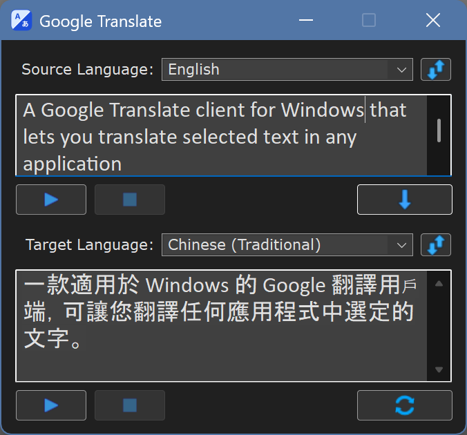

# Google Translate for AutoHotkey v2

A Google Translate client for Windows that lets you translate selected text in any application with a hotkey or work in a separate translator window. It supports speech for both the source text and the translation. No registration or personal API key is required.

## Quick start

1. Install AutoHotkey v2.0 and run the script.
2. On the first run, wait while the language data is prepared. In the language selection window that opens, review the suggested pair or choose the languages yourself, then click **Save**.
3. To translate text in any application, select it and press `Ctrl+C+C`: hold `Ctrl` and press `C` twice in succession. The translation appears in the translator window.
4. Double-click the program's tray icon to open the translator window.

## Language setup

To choose the translation direction automatically, the program uses a “native language — second language” pair. The native language is your primary language, into which foreign text is usually translated; the second is the language you work with most often. For example, with a Russian–English pair, English text is translated into Russian and Russian text into English. If the direction cannot be determined, the program translates into the native language.

The language pair sets the default direction but does not restrict manual selection: you can choose any supported source and target languages in the translator window.

On the first run, the program suggests a pair and asks you to confirm it in a prefilled selection window. The Windows display language is suggested as the native language, and the second one is taken from the Windows preferred language list; if that does not give a second language, regional settings, the current keyboard layout, or English as a fallback are used. If the second language cannot be inferred, you need to choose it yourself. The confirmed pair is saved and used on subsequent runs.

You can change the pair at any time: right-click the program's tray icon, select `Languages...`, choose the native and second languages, and click **Save**. The program restarts with the new pair. You can also open the language selection window at startup by passing the `--language-setup` parameter to the script.

### Automatic translation direction

When translating selected text, the program tries to determine which language in the pair it belongs to and selects the other language as the target. It considers the writing system and characteristic clues for certain languages, while Google continues to detect the source language automatically. If the direction remains ambiguous, the program first translates into the native language. If Google detects the source language as matching the selected target, the program retries once in the opposite direction.

## Translator window

In the top field, you can type or paste the source text, select the source and target languages, then click the translate button or press `Enter`. If a fragment is selected in the field, that fragment is translated. To insert a line break, press `Shift+Enter`.

The reverse translation button translates text from the bottom field in the opposite direction. Pressing `Enter` in the bottom field does the same. The buttons next to the language lists swap the source and target languages; `Ctrl+Tab` in the translator window does the same. When the source language is detected automatically, there is nothing to swap, and a notice says so. Pointing to a button shows a tooltip in your native language.

You can resize the window with the mouse: dragging the top edge enlarges the top text field, while dragging the bottom edge enlarges the bottom field. When the window is taller than its minimum height, that is, when at least one field has been enlarged, you can also change the ratio of the fields without changing the window height: drag the bottom edge of the top field or the top edge of the bottom one. After a translation, the bottom field grows to fit it, unless `Remember Window Size` is turned on in the `Options` submenu of the tray menu. To change the font size of an individual field, point to it, hold `Ctrl`, and scroll the mouse wheel.

## Tray menu

Right-click the program's tray icon to open the settings menu. The on/off settings, except `Windowless Mode`, are in the `Options` submenu. The main commands are:

| Command | Purpose |
| --- | --- |
| `Open GUI` | Open the translator window |
| `Languages...` | Change the “native language — second language” pair |
| `Windowless Mode` | Translate selected text without showing the window and replace the selection with the translation. If you switch to another window or field before the translation arrives, it is only copied to the clipboard |
| `Options` → `Dark Theme` | Switch between dark and light themes |
| `Options` → `Use Multiple GUIs` | Open a separate window for each new translation |
| `Options` → `Copy Main Translation` | Automatically copy the main translation to the clipboard |
| `Options` → `Remember Window Size` | Keep the window width and the heights of both text fields: new windows open with this size, and a translation does not resize the window |
| `Options` → `Switch Keyboard Layout` | When a text field gets the focus, switch the keyboard layout to the language of that field, if such a layout is installed. If Windows uses one layout for all windows, the previous layout is restored when you leave the translator window. In the language lists the layout of the native language is used, as the language names are in it. On by default |
| `Options` → `Show Romanization` | Show the romanization of text in a non-Latin script (pinyin, romaji, transliterated Cyrillic) in a strip under its text field. The strip appears only for such text; a long romanization scrolls, and hovering over the strip shows all of it. It comes from a separate Google service: if Google does not answer it, only the romanization is missing, not the translation. Off by default |
| `Add To Startup` | Enable or disable starting the program with Windows |
| `Clear Cache` | Clear cached translations and speech |

Double-clicking the icon runs `Open GUI`. The menu also provides commands for opening the script folder, reloading the program, and exiting. When the source `.ahk` file is running, the `Edit This Script` command is also shown.

## Key features

- The program automatically chooses the direction within the saved language pair.
- Additional meanings and translation variants may be shown for individual words.
- Long text is automatically split into request-sized parts and assembled into a single translation.
- Line breaks inside a sentence, as in text copied from PDF files or e-mail, are joined before translation, so the sentence is translated as a whole. The source text itself is shown unchanged.
- If every line of the text starts with the same comment or quote marker (`;`, `//`, `#`, `--`, `%`, `>`), the marker is taken off before translation and put back on each line of the result. A comment of several lines is wrapped to its original width, so the translation can be pasted back into the code.
- Dark and light themes, multiple translator windows, and windowless operation are supported.

## Cache

Translations and speech are stored in a cache on disk and remain available after the program restarts. When the cache fills up, the oldest entries are replaced. Its size is limited to 100 MB by default; you can change this value with `Cache Size MB` in `settings.ini`. Use `Clear Cache` in the tray menu to clear it.

## Speech

The playback buttons next to the text fields let you hear the source text or translation, pause playback, and stop it. For individual English words, Oxford dictionary pronunciation is used when available; Google TTS is used otherwise.

Speech playback uses Windows Media Foundation components. Windows N/KN editions may require the Media Feature Pack.

## System requirements

- Windows 10/11
- AutoHotkey v2.0 when running the source `.ahk` file
- An internet connection for initial setup, new translations, and speech
- A writable script folder: settings, the language list, and the cache are stored there

Text being translated or spoken is sent to Google services. The program uses the same Google Translate interfaces as Google's own browser-side clients (Google Translate website translation and the Google Dictionary extension), so a personal API key is not required. The API keys in the source code are the public keys built into those Google clients, not the author's personal keys: they are not linked to anyone's Google Cloud account, and nobody is billed for using the program. Google may change these interfaces. This is an unofficial project and is not affiliated with or endorsed by Google.

## Author and license

Author: jollycoder (known as teadrinker on the AutoHotkey forums).

This project is licensed under the MIT License. See [LICENSE](LICENSE) for details.
