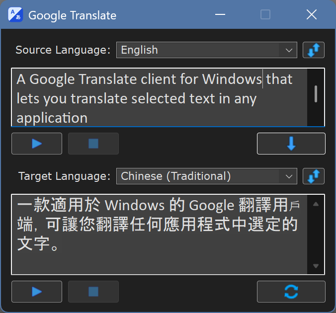

# Google Translate для AutoHotkey v2

Клиент Google Translate для Windows, позволяющий переводить выделенный текст из любого приложения с помощью горячей клавиши или работать через отдельное окно переводчика. Поддерживает озвучивание исходного текста и перевода. Регистрация и собственный API-ключ не требуются.

## Быстрый старт

1. Установите AutoHotkey v2.0 и запустите скрипт.
2. При первом запуске дождитесь подготовки языковых данных. Если откроется окно выбора языков, проверьте предложенную пару или укажите языки самостоятельно и нажмите «Сохранить».
3. Чтобы перевести текст из любого приложения, выделите его и нажмите `Ctrl+C+C`: удерживая `Ctrl`, нажмите `C` два раза подряд. Перевод появится в окне переводчика.
4. Открыть окно переводчика можно двойным щелчком по иконке программы в трее.

## Настройка языков

Для автоматического выбора направления перевода программа использует пару «родной язык — второй язык». Родной язык — ваш основной язык, на который обычно переводится иностранный текст; второй — язык, с которым вы чаще всего работаете. Например, для пары «русский — английский» английский текст переводится на русский, а русский — на английский. Если направление определить не удаётся, программа переводит на родной язык.

Языковая пара задаёт направление по умолчанию, но не ограничивает ручной выбор: в окне переводчика можно указать любые поддерживаемые исходный и целевой языки.

При первом запуске программа пытается выбрать пару автоматически. Сначала она проверяет список предпочитаемых языков Windows. Если в нём найдены два разных поддерживаемых языка, первые два из них сохраняются автоматически. Если для составления пары потребовались дополнительные сведения — язык интерфейса Windows, региональные настройки, текущая раскладка клавиатуры или запасной английский язык, — программа показывает заполненное окно выбора и просит подтвердить предложенный вариант. Если второй язык надёжно определить нельзя, его нужно выбрать самостоятельно. Выбранная пара сохраняется и используется при последующих запусках.

Изменить пару можно в любое время: щёлкните правой кнопкой мыши по иконке программы в трее, выберите `Languages...`, укажите родной и второй языки и нажмите «Сохранить». После сохранения программа перезапустится с новой парой. Окно выбора языков также можно открыть при запуске, передав скрипту параметр `--language-setup`.

### Автоматический выбор направления перевода

При переводе выделенного текста программа пытается определить, к какому языку пары он относится, и выбирает противоположный язык для перевода. Для этого учитываются письменность и характерные признаки некоторых языков, а исходный язык запроса по-прежнему определяется Google автоматически. Если направление остаётся неоднозначным, сначала выполняется перевод на родной язык. Если Google определит исходный язык как совпадающий с выбранным целевым, программа один раз попробует обратное направление.

## Окно переводчика

В верхнем поле можно ввести или вставить исходный текст, выбрать исходный и целевой языки, а затем нажать кнопку перевода или `Enter`. Если в поле выделен фрагмент текста, переводится этот фрагмент. Чтобы вставить перенос строки, нажмите `Shift+Enter`.

Кнопка обратного перевода переводит текст из нижнего поля в обратном направлении. То же делает `Enter`, нажатый в нижнем поле. Кнопки рядом со списками языков меняют исходный и целевой языки местами. При наведении указателя на кнопку появляется подсказка на родном языке.

Размер окна можно изменять мышью: при растягивании за верхний край увеличивается верхнее текстовое поле, а за нижний — нижнее. Если высота окна больше минимальной, то есть хотя бы одно поле увеличено, можно изменить и соотношение полей, не меняя высоту окна: перетащите нижнюю границу верхнего поля или верхнюю границу нижнего. После перевода нижнее поле увеличивается под текст, если в меню трея не включено `Remember Window Size`. Чтобы изменить размер шрифта отдельного поля, наведите на него указатель, удерживайте `Ctrl` и прокручивайте колесо мыши.

## Меню трея

Щёлкните правой кнопкой мыши по иконке программы, чтобы открыть меню настроек. Основные команды:

| Команда | Назначение |
| --- | --- |
| `Open GUI` | Открыть окно переводчика |
| `Languages...` | Изменить пару «родной язык — второй язык» |
| `Dark Theme` | Переключить тёмную и светлую темы |
| `Use Multiple GUIs` | Открывать отдельное окно для каждого нового перевода |
| `Windowless Mode` | Не показывать окно при переводе выделенного текста, а заменить выделение готовым переводом. Если до получения перевода переключиться в другое окно или поле, перевод только копируется в буфер обмена |
| `Copy Main Translation` | Автоматически копировать основной перевод в буфер обмена |
| `Remember Window Size` | Запоминать ширину окна и высоты обоих текстовых полей: новые окна открываются с этими размерами, а перевод не меняет размер окна |
| `Add To Startup` | Включить или отключить запуск программы вместе с Windows |
| `Clear Cache` | Очистить кэш переводов и озвучки |

Двойной щелчок по иконке выполняет команду `Open GUI`. В меню также доступны открытие папки скрипта, перезапуск и завершение программы. При запуске исходного `.ahk`-файла дополнительно показывается команда `Edit This Script`.

## Основные возможности

- Программа автоматически выбирает направление внутри сохранённой языковой пары.
- При переводе отдельных слов могут отображаться дополнительные значения и варианты перевода.
- Длинный текст автоматически разбивается на подходящие для запроса части, а результат собирается в единый перевод.
- Переносы строк внутри предложения, например в тексте, скопированном из PDF или письма, перед переводом убираются, и предложение переводится целиком. Сам исходный текст при этом показывается без изменений.
- Если все строки текста начинаются с одного и того же маркера комментария или цитаты (`;`, `//`, `#`, `--`, `%`, `>`), маркер перед переводом убирается и возвращается в начало каждой строки результата. Многострочный комментарий переносится по исходной ширине, так что перевод можно вставить обратно в код.
- Поддерживаются тёмная и светлая темы, несколько окон переводчика и режим работы без окна.

## Кэш

Переводы и озвучка сохраняются в кэше на диске и доступны после перезапуска программы. Когда кэш заполняется, самые старые записи заменяются новыми. По умолчанию его размер ограничен 100 МБ; изменить это значение можно параметром `Cache Size MB` в файле `settings.ini`. Для очистки используйте `Clear Cache` в меню трея.

## Озвучивание

Кнопки воспроизведения рядом с текстовыми полями позволяют озвучить исходный текст или перевод, приостановить воспроизведение и остановить его. Для отдельных английских слов используется словарное произношение Oxford, когда оно доступно; в остальных случаях применяется Google TTS.

Озвучивание использует компоненты Windows Media Foundation. В редакциях Windows N/KN для этого может потребоваться установка Media Feature Pack.

## Системные требования

- Windows 10/11
- AutoHotkey v2.0 для запуска исходного `.ahk`-файла
- Подключение к интернету для первоначальной настройки, новых переводов и озвучивания
- Папка скрипта, доступная для записи: в ней хранятся настройки, список языков и кэш

Для перевода и озвучивания обрабатываемый текст отправляется сервисам Google. Программа обращается к тем же интерфейсам Google Translate, что и собственные браузерные клиенты Google (перевод сайтов в Google Translate и расширение Google Dictionary), поэтому собственный API-ключ не требуется. API-ключи в исходном коде — публичные ключи, встроенные в эти клиенты Google, а не личные ключи автора: они не привязаны ни к чьему аккаунту Google Cloud, и за использование программы никому не выставляется счёт. Эти интерфейсы могут измениться со стороны Google.

## Автор и лицензия

Автор: jollycoder (на форумах AutoHotkey — teadrinker).

Проект распространяется по лицензии MIT. Подробности — в файле [LICENSE](LICENSE).
