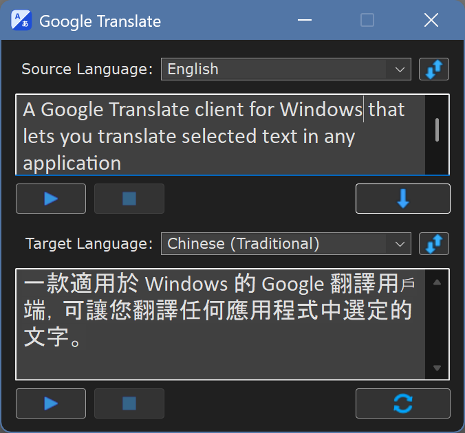

# Google Translate для AutoHotkey v2

Клиент Google Translate для Windows, позволяющий переводить выделенный текст из любого приложения с помощью горячей клавиши или работать через отдельное окно переводчика. Поддерживает озвучивание исходного текста и перевода. Регистрация и собственный API-ключ не требуются.

## Быстрый старт

1. Установите AutoHotkey v2.0 и запустите скрипт.
2. При первом запуске дождитесь подготовки языковых данных. В открывшемся окне выбора языков проверьте предложенную пару или укажите языки самостоятельно и нажмите «Сохранить».
3. Чтобы перевести текст из любого приложения, выделите его и нажмите `Ctrl+C+C`: удерживая `Ctrl`, нажмите `C` два раза подряд. Перевод появится в окне переводчика.
4. Открыть окно переводчика можно двойным щелчком по иконке программы в трее.

## Настройка языков

Для автоматического выбора направления перевода программа использует пару «родной язык — второй язык». Родной язык — ваш основной язык, на который обычно переводится иностранный текст; второй — язык, с которым вы чаще всего работаете. Например, для пары «русский — английский» английский текст переводится на русский, а русский — на английский. Если направление определить не удаётся, программа переводит на родной язык.

Языковая пара задаёт направление по умолчанию, но не ограничивает ручной выбор: в окне переводчика можно указать любые поддерживаемые исходный и целевой языки.

При первом запуске программа предлагает пару и просит подтвердить её в заполненном окне выбора. Родным предлагается язык интерфейса Windows, вторым — язык из списка предпочитаемых языков Windows; если второго языка там нет, используются региональные настройки, текущая раскладка клавиатуры или запасной английский язык. Если второй язык определить нельзя, его нужно выбрать самостоятельно. Подтверждённая пара сохраняется и используется при последующих запусках.

Изменить пару можно в любое время: щёлкните правой кнопкой мыши по иконке программы в трее, выберите `Languages...`, укажите родной и второй языки и нажмите «Сохранить». После сохранения программа перезапустится с новой парой. Окно выбора языков также можно открыть при запуске, передав скрипту параметр `--language-setup`.

### Автоматический выбор направления перевода

При переводе выделенного текста программа пытается определить, к какому языку пары он относится, и выбирает противоположный язык для перевода. Для этого учитываются письменность и характерные признаки некоторых языков, а исходный язык запроса по-прежнему определяется Google автоматически. Если направление остаётся неоднозначным, сначала выполняется перевод на родной язык. Если Google определит исходный язык как совпадающий с выбранным целевым, программа один раз попробует обратное направление.

## Окно переводчика

В верхнем поле можно ввести или вставить исходный текст, выбрать исходный и целевой языки, а затем нажать кнопку перевода или `Enter`. Чтобы вставить перенос строки, нажмите `Shift+Enter`.

Кнопка обратного перевода переводит текст из нижнего поля в обратном направлении. То же делает `Enter`, нажатый в нижнем поле. Кнопки рядом со списками языков меняют исходный и целевой языки местами; то же делает `Ctrl+Tab` в окне переводчика. Если исходный язык определяется автоматически, менять нечего, и об этом появляется уведомление. При наведении указателя на кнопку появляется подсказка на родном языке.

Если в поле выделен фрагмент текста, перевод и озвучивание этого поля работают только с ним: кнопкой перевода (или `Enter`) переводится, а кнопкой воспроизведения озвучивается выделенный фрагмент, а не весь текст. Так можно, например, перевести одно предложение из длинного текста или прослушать один из вариантов перевода.

Размер окна можно изменять мышью: при растягивании за верхний край увеличивается верхнее текстовое поле, а за нижний — нижнее. Если высота окна больше минимальной, то есть хотя бы одно поле увеличено, можно изменить и соотношение полей, не меняя высоту окна: перетащите нижнюю границу верхнего поля или верхнюю границу нижнего. После перевода нижнее поле увеличивается под текст, если в подменю `Options` меню трея не включено `Remember Window Size`. Чтобы изменить размер шрифта отдельного поля, наведите на него указатель, удерживайте `Ctrl` и прокручивайте колесо мыши.

### Транскрипция

Если включён пункт `Options` → `Show Romanization`, под полем с текстом, написанным не латиницей, появляется полоса с его латинской транскрипцией: пиньинь для китайского, ромадзи для японского, транслитерация для кириллицы и т. д. Полоса выделена фоном, показывает две строки и использует шрифт того же размера, что и поле; переносы строк в ней те же, что в тексте.

Транскрипция связана с текстом. Щелчок или выделение в поле выделяет соответствующую часть транскрипции и прокручивает к ней полосу, а прокрутка поля колесом прокручивает и полосу. Щелчок в полосе, наоборот, выделяет соответствующую часть текста в поле. Колесо мыши над полосой прокручивает её по одной строке, а поле прокручивается к соответствующему тексту. Если полоса в фокусе (после щелчка в ней), колесо работает как клавиши со стрелками вверх и вниз: перемещает курсор по строкам и тоже выделяет соответствующую часть текста. Частями служат предложения; длинное предложение делится по знакам препинания на куски, которые помещаются в полосу, и при изменении ширины окна деление подстраивается. Если Google вернёт транскрипцию, которую не удаётся сопоставить с текстом, она показывается без такой связи.

Транскрипцию даёт отдельный сервис Google. Если он временно не отвечает, например из-за частых запросов, новая транскрипция не появляется, но уже полученная по-прежнему берётся из кэша; примерно через две минуты программа пробует снова. Перевод от этого не зависит.

### Произношение

Если включён пункт `Options` → `Show Pronunciation`, в строке кнопок поля, между кнопкой остановки и кнопкой перевода, показывается словарное произношение слова, например `[ˈwôdər]` для *water*. Google даёт его только для отдельных слов английского, итальянского и немецкого языков, и не для каждого слова.

После перевода показывается произношение текста поля, если это одно слово, а для нижнего поля — основного перевода, без списка вариантов. Чтобы узнать произношение другого слова, например одного из вариантов перевода или слова во фразе, дважды щёлкните по нему: появятся слово и его произношение. Пока ответ не получен, после слова бегут точки. `[—]` означает, что у Google нет произношения этого слова, `[?]` — что Google не ответил; попробуйте позже. Когда выделение снято, снова показывается произношение основного слова поля.

Это запись из словарей Google, а не международная фонетическая транскрипция (МФА). В английской записи заглавные сочетания вроде `TH`, `SH`, `NG` обозначают один звук, в итальянской слово разбито на слоги с ударением (`cà·sa`), в немецкой отмечено только ударение (`Haús`).

## Меню трея

Щёлкните правой кнопкой мыши по иконке программы, чтобы открыть меню настроек. Переключаемые настройки, кроме `Windowless Mode`, собраны в подменю `Options`. Основные команды:

| Команда | Назначение |
| --- | --- |
| `Open GUI` | Открыть окно переводчика |
| `Languages...` | Изменить пару «родной язык — второй язык» |
| `Windowless Mode` | Не показывать окно при переводе выделенного текста, а заменить выделение готовым переводом. Если до получения перевода переключиться в другое окно или поле, перевод только копируется в буфер обмена |
| `Options` → `Dark Theme` | Переключить тёмную и светлую темы |
| `Options` → `Use Multiple GUIs` | Открывать отдельное окно для каждого нового перевода |
| `Options` → `Copy Main Translation` | Автоматически копировать основной перевод в буфер обмена |
| `Options` → `Remember Window Size` | Запоминать ширину окна и высоты обоих текстовых полей: новые окна открываются с этими размерами, а перевод не меняет размер окна |
| `Options` → `Switch Keyboard Layout` | При переходе в текстовое поле переключать раскладку клавиатуры на язык этого поля, если такая раскладка установлена. Если в Windows одна раскладка для всех окон, при уходе из окна переводчика возвращается прежняя. В списках языков включается раскладка родного языка: названия языков написаны на нём. Включено по умолчанию |
| `Options` → `Show Romanization` | Показывать латинскую транскрипцию текста, написанного не латиницей, в полосе под его текстовым полем (см. «Транскрипция»). По умолчанию выключено |
| `Options` → `Show Pronunciation` | Показывать словарное произношение отдельных английских, итальянских и немецких слов в строке кнопок поля (см. «Произношение»). По умолчанию выключено |
| `Add To Startup` | Включить или отключить запуск программы вместе с Windows |
| `Clear Cache` | Очистить кэш переводов, озвучки, транскрипции и произношения |

Двойной щелчок по иконке выполняет команду `Open GUI`. В меню также доступны открытие папки скрипта, перезапуск и завершение программы. При запуске исходного `.ahk`-файла дополнительно показывается команда `Edit This Script`.

## Основные возможности

- Программа автоматически выбирает направление внутри сохранённой языковой пары.
- При переводе отдельных слов могут отображаться дополнительные значения и варианты перевода.
- Длинный текст автоматически разбивается на подходящие для запроса части, а результат собирается в единый перевод.
- Переносы строк внутри предложения, например в тексте, скопированном из PDF или письма, перед переводом убираются, и предложение переводится целиком. Сам исходный текст при этом показывается без изменений.
- Если все строки текста начинаются с одного и того же маркера комментария или цитаты (`;`, `//`, `#`, `--`, `%`, `>`), маркер перед переводом убирается и возвращается в начало каждой строки результата. Многострочный комментарий переносится по исходной ширине, так что перевод можно вставить обратно в код.
- Поддерживаются тёмная и светлая темы, несколько окон переводчика и режим работы без окна.

## Кэш

Переводы, озвучка, транскрипция и произношение сохраняются в кэше на диске и доступны после перезапуска программы. Когда кэш заполняется, самые старые записи заменяются новыми. По умолчанию его размер ограничен 100 МБ; изменить это значение можно параметром `Cache Size MB` в файле `settings.ini`. Для очистки используйте `Clear Cache` в меню трея.

## Озвучивание

Кнопки воспроизведения рядом с текстовыми полями позволяют озвучить исходный текст или перевод, приостановить воспроизведение и остановить его. Если в поле выделен фрагмент текста, озвучивается только он. Для отдельных английских слов используется словарное произношение Oxford, когда оно доступно; в остальных случаях применяется Google TTS.

Озвучивание использует компоненты Windows Media Foundation. В редакциях Windows N/KN для этого может потребоваться установка Media Feature Pack.

## Системные требования

- Windows 10/11
- AutoHotkey v2.0 для запуска исходного `.ahk`-файла
- Подключение к интернету для первоначальной настройки, новых переводов и озвучивания
- Папка скрипта, доступная для записи: в ней хранятся настройки, список языков и кэш

Для перевода и озвучивания обрабатываемый текст отправляется сервисам Google. Программа обращается к тем же интерфейсам Google Translate, что и собственные браузерные клиенты Google (перевод сайтов в Google Translate и расширение Google Dictionary), поэтому собственный API-ключ не требуется. API-ключи в исходном коде — публичные ключи, встроенные в эти клиенты Google, а не личные ключи автора: они не привязаны ни к чьему аккаунту Google Cloud, и за использование программы никому не выставляется счёт. Эти интерфейсы могут измениться со стороны Google.

## Автор и лицензия

Автор: jollycoder (на форумах AutoHotkey — teadrinker).

Проект распространяется по лицензии MIT. Подробности — в файле [LICENSE](LICENSE).
